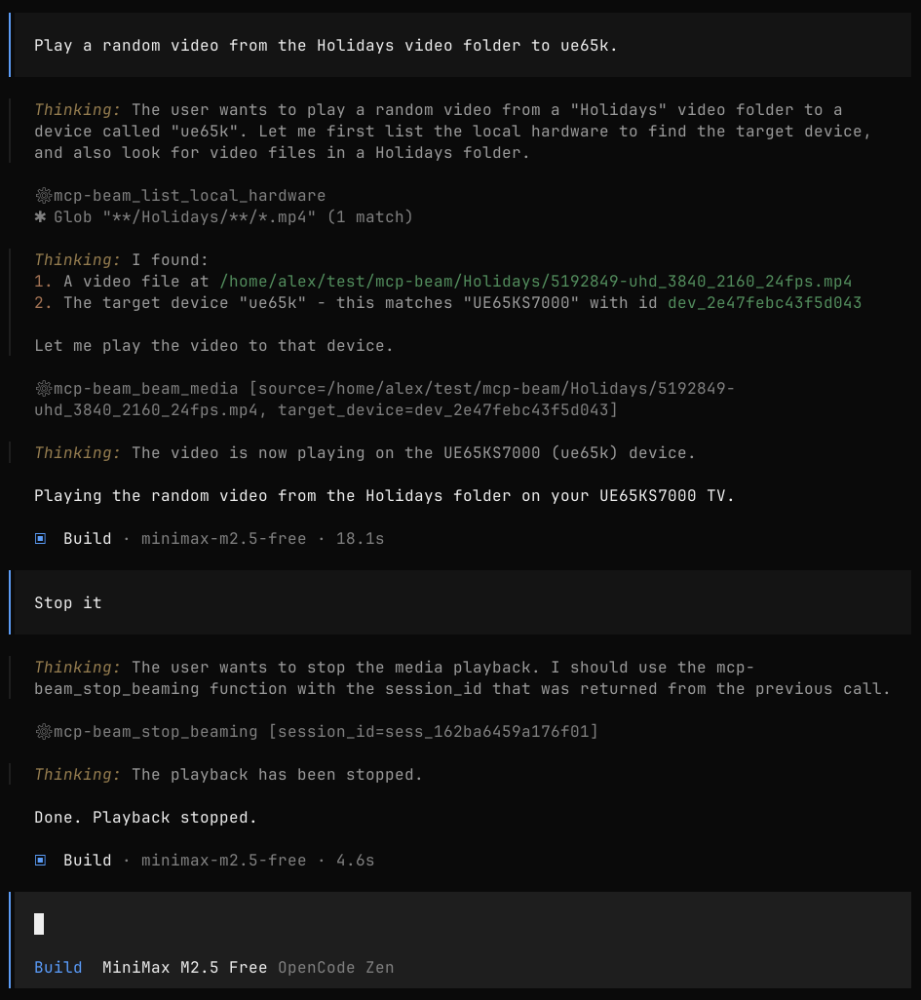

# mcp-beam


## Demo



`mcp-beam` is a MCP server (`stdio` transport) for casting local files, media URLs, and torrents to Chromecast and DLNA/UPnP devices on your LAN. It speaks both the `2026-07-28` and `2024-11-05` protocol revisions.

It exposes eight tools:

- `list_local_hardware`
- `inspect_torrent`
- `beam_media`
- `get_beaming_status`
- `play_beaming`
- `pause_beaming`
- `seek_beaming`
- `stop_beaming`

## Highlights

- One server for both Chromecast and DLNA/UPnP workflows.
- Stable device IDs for reliable follow-up calls.
- Protocol-aware direct play and transcoding decisions.
- Local `.torrent` and magnet sources with explicit file selection and download progress.
- External, sidecar, and embedded subtitles with receiver rendering or video burn-in.
- Safe-by-default path, URL, and bind policies.
- Structured errors with practical remediation hints.

## Table of Contents

- [Demo](#demo)
- [Quick Start](#quick-start)
- [Installation](#installation)
- [Runtime Dependencies](#runtime-dependencies)
  - [Go Installation](#go-installation)
- [Protocol Support](#protocol-support)
- [Tool Reference](#tool-reference)
- [Transcode Behavior](#transcode-behavior)
- [Error Model](#error-model)
- [Environment Variables](#environment-variables)
- [Security](#security)
- [Architecture](#architecture)
- [Troubleshooting](#troubleshooting)
- [Development](#development)

## Quick Start

Get beaming in a few minutes.

### 1) Add `mcp-beam` to your MCP host config

CLI one-liners:

```bash
# Claude Code
claude mcp add --scope user mcp-beam -- go run go2tv.app/mcp-beam@latest

# Codex
codex mcp add mcp-beam -- go run go2tv.app/mcp-beam@latest

# Gemini
gemini mcp add mcp-beam go run go2tv.app/mcp-beam@latest
```

Generic JSON configuration (for MCP hosts using `mcpServers`):

```json
{
  "mcpServers": {
    "mcp-beam": {
      "command": "go",
      "args": [
        "run",
        "go2tv.app/mcp-beam@latest"
      ]
    }
  }
}
```

Notes:
- Requires `go` in `PATH` (Go `1.26.9+`).
- The first run may be slower due to module download/build.

### 2) Verify the server binary/module wiring

```bash
go run go2tv.app/mcp-beam@latest --version
go run go2tv.app/mcp-beam@latest --self-test
```

### 3) Run the tool flow

1. Call `list_local_hardware` and pick a device `id`.
2. For torrent sources, call `inspect_torrent` and choose a file index when the torrent contains multiple supported media files.
3. Call `beam_media` with `source` and `target_device`.
4. Call `get_beaming_status`, `play_beaming`, `pause_beaming`, or `seek_beaming` as needed.
5. Call `stop_beaming` when done.

Minimal example flow:

```json
{
  "name": "list_local_hardware",
  "arguments": {
    "timeout_ms": 3000,
    "include_unreachable": false
  }
}
```

```json
{
  "name": "beam_media",
  "arguments": {
    "source": "/absolute/path/to/video.mp4",
    "target_device": "dev_1234abcd",
    "transcode": "auto"
  }
}
```

```json
{
  "name": "get_beaming_status",
  "arguments": {
    "session_id": "sess_abcd1234"
  }
}
```

```json
{
  "name": "pause_beaming",
  "arguments": {
    "session_id": "sess_abcd1234"
  }
}
```

```json
{
  "name": "play_beaming",
  "arguments": {
    "session_id": "sess_abcd1234"
  }
}
```

```json
{
  "name": "seek_beaming",
  "arguments": {
    "session_id": "sess_abcd1234",
    "mode": "percent",
    "value": 50
  }
}
```

```json
{
  "name": "stop_beaming",
  "arguments": {
    "session_id": "sess_abcd1234"
  }
}
```

## Installation

### Published module (recommended)

```bash
go run go2tv.app/mcp-beam@latest --version
go run go2tv.app/mcp-beam@latest --self-test
```

### Local checkout

From repo root:

```bash
go run . --version
go run . --self-test
```

Use this MCP config to run directly from source:

macOS/Linux:

```json
{
  "mcpServers": {
    "mcp-beam": {
      "command": "/bin/bash",
      "args": [
        "-lc",
        "cd /absolute/path/to/mcp-beam && go run ."
      ]
    }
  }
}
```

Windows PowerShell:

```json
{
  "mcpServers": {
    "mcp-beam": {
      "command": "powershell",
      "args": [
        "-NoProfile",
        "-Command",
        "Set-Location 'C:\\absolute\\path\\to\\mcp-beam'; go run ."
      ]
    }
  }
}
```

### Downloaded binary

Build locally:

```bash
go build -o ./bin/mcp-beam .
./bin/mcp-beam --version
./bin/mcp-beam --self-test
```

Or install from releases:
- `https://github.com/alexballas/mcp-beam/releases`

Linux/macOS checksum verify:

```bash
shasum -a 256 -c SHA256SUMS
```

Windows checksum verify:

```powershell
Get-FileHash .\mcp-beam_<version>_windows_amd64.zip -Algorithm SHA256
```

Linux/macOS unpack:

```bash
tar -xzf mcp-beam_<version>_<os>_<arch>.tar.gz
./mcp-beam_<version>_<os>_<arch>/mcp-beam --version
./mcp-beam_<version>_<os>_<arch>/mcp-beam --self-test
```

Windows unpack:

```powershell
Expand-Archive .\mcp-beam_<version>_windows_amd64.zip -DestinationPath .
.\mcp-beam_<version>_windows_amd64\mcp-beam.exe --version
.\mcp-beam_<version>_windows_amd64\mcp-beam.exe --self-test
```

MCP config for a local binary:

```json
{
  "mcpServers": {
    "mcp-beam": {
      "command": "/absolute/path/to/mcp-beam",
      "args": []
    }
  }
}
```

## Runtime Dependencies

- `go` (Go 1.26.9+) is required when using `go run`, building locally, or packaging releases. See [Go Installation](#go-installation) below.
- Downloaded release binaries do not require a local Go installation.
- `ffmpeg` and `ffprobe` are optional for non-transcoding paths, but recommended.
  - If transcoding is required and `ffmpeg` is unavailable, calls return `FFMPEG_NOT_FOUND`.
  - Local embedded subtitle selection and ASS/SSA subtitle conversion also require FFmpeg.

### Go Installation

#### Linux

Download and install from https://go.dev/dl/ or via package manager:

- Debian/Ubuntu: `sudo apt install golang-go`
- Fedora: `sudo dnf install golang`
- Arch: `sudo pacman -S go`

#### macOS

Download and install from https://go.dev/dl/ or use Homebrew:

```bash
brew install go
```

#### Windows

Download and install from https://go.dev/dl/

#### Verify Installation

```bash
go version
```

Should output: `go1.26.9` or higher.

Install examples:
- Linux: package manager (for example `sudo apt install ffmpeg`)
- macOS: `brew install ffmpeg`
- Windows: install FFmpeg and add `bin` to `PATH`

Verify:
- Linux/macOS: `command -v ffmpeg && command -v ffprobe`
- Windows: `where ffmpeg` and `where ffprobe`

## Protocol Support

`mcp-beam` serves two MCP revisions concurrently and picks between them per request, so hosts on either era work against the same binary.

| Revision | Selected by | Notes |
| --- | --- | --- |
| `2026-07-28` | A request carrying `io.modelcontextprotocol/protocolVersion` in `params._meta` | Stateless; version, identity, and capabilities travel per request. |
| `2024-11-05` | An `initialize` handshake, or any request without that `_meta` | Legacy handshake, served unchanged. |

Methods:

| Method | Revision |
| --- | --- |
| `server/discover` | `2026-07-28` |
| `initialize` | `2024-11-05` |
| `tools/list`, `tools/call` | both |

For stdio, cancel an in-progress tool call with a `notifications/cancelled` notification whose `params.requestId` matches the call's JSON-RPC ID. Cancellation stops work through the call's context and suppresses its response. Malformed notifications and unknown or completed IDs are ignored. A cancellation that arrives after a response has started may still receive that response.

When stdin closes, the server allows in-progress calls two seconds to finish, then cancels outstanding work before shutdown.

Notes for `2026-07-28` clients:
- Every request must carry `io.modelcontextprotocol/protocolVersion` and `io.modelcontextprotocol/clientCapabilities` in `params._meta`. A missing field is `-32602`.
- An unsupported version returns `-32022` with `data.supported` listing the versions to retry with.
- `server/discover` and `tools/list` are cacheable and carry `ttlMs` and `cacheScope`.
- Results are always `resultType: "complete"`. `mcp-beam` never returns `input_required`: it needs no sampling, elicitation, or roots.

The `session_id` returned by `beam_media` is the explicit handle the stateless model calls for. Sessions are process-local and do not survive a restart; see the session lifecycle defaults under [Architecture](#architecture) for how long they are retained.

## Tool Reference

### `list_local_hardware`

Discover Chromecast and DLNA/UPnP renderers on the local network.

Arguments:
- `timeout_ms` (optional integer, minimum `100`, default `5000`)
- `include_unreachable` (optional boolean, default `false`)

Example:

```json
{
  "name": "list_local_hardware",
  "arguments": {
    "timeout_ms": 5000,
    "include_unreachable": false
  }
}
```

On success, `structuredContent` includes:
- `count`
- `devices[]` entries:
- `id`
- `name`
- `type`
- `address`
- `is_audio_only`
- `protocol` (`chromecast` or `dlna`)
- `capabilities.supports_file_source`
- `capabilities.supports_url_source`
- `capabilities.supports_hls_m3u8_url`
- `capabilities.limitations[]`

### `inspect_torrent`

Inspect the file list in a local `.torrent` file or magnet URI before casting. This does not start playback.

Arguments:

- `source` (required string): absolute local `.torrent` path or magnet URI
- `timeout_ms` (optional integer, `1000` to `120000`, default `60000`): timeout for torrent preparation and metadata retrieval

Example:

```json
{
  "name": "inspect_torrent",
  "arguments": {
    "source": "/absolute/path/to/movie.torrent",
    "timeout_ms": 60000
  }
}
```

On success, `structuredContent` contains `ok` and `files[]` for supported media files. Each file contains `index` (its original zero-based torrent file index), `name`, and `size_bytes`. For a torrent containing multiple supported media files, select the desired media file and pass its `index` as `beam_media.arguments.torrent_file_index`. The index can be omitted when the torrent contains exactly one supported media file.

The text content also lists each supported file's original `index`, quoted `name`, and `size_bytes`, so clients that read only text can select a file. An empty list reports that the torrent contains no supported media files to beam.

Magnet URIs require peers to retrieve metadata. Increase `timeout_ms` when retrieval is slow; this timeout applies only to inspection. `beam_media` gives metadata retrieval 60 seconds. Later media preparation and device startup have separate timeouts, so the full call can take longer.

### `beam_media`

Start playback on a selected discovered device.

Arguments:
- `source` (required string): absolute local media path, `http`/`https` media URL, absolute local `.torrent` path, or magnet URI
- `target_device` (required string): stable device ID preferred, exact name fallback
- `transcode` (optional string): `auto` (default), `always`, `never`
- `subtitles_path` (optional string): absolute local external subtitle file path (`.srt`, `.vtt`, `.ass`, or `.ssa`); takes precedence over sidecar and embedded subtitles
- `torrent_file_index` (optional integer, minimum `0`): file index from `inspect_torrent`; required when a torrent contains multiple supported media files
- `subtitle_mode` (optional string): `auto` (default), `receiver`, `burn`, or `off`
- `embedded_subtitle_track` (optional integer, minimum `0`): zero-based subtitle track index in a local media file
- `start_seconds` (optional integer, minimum `0`): start offset from the beginning of media

Example:

```json
{
  "name": "beam_media",
  "arguments": {
    "source": "/absolute/path/to/media.mp4",
    "target_device": "dev_1234abcd",
    "transcode": "auto",
    "subtitles_path": "/absolute/path/to/subs.srt",
    "start_seconds": 60
  }
}
```

On success, `structuredContent` includes:
- `ok`
- `session_id`
- `device_id`
- `media_url`
- `transcoding`
- `warnings[]`
- optional `torrent`: `file_index`, `file_name`, `downloaded_bytes`, `total_bytes`, and `progress_percent` for the selected file

Torrent example:

```json
{
  "name": "beam_media",
  "arguments": {
    "source": "/absolute/path/to/movie.torrent",
    "torrent_file_index": 1,
    "target_device": "dev_1234abcd",
    "subtitle_mode": "auto"
  }
}
```

Protocol notes:
- Chromecast supports local files and URL sources.
- Chromecast supports direct `.m3u8` HLS URL casting.
- DLNA supports local files and URL sources with direct-first then proxy fallback behavior.
- DLNA `.m3u8` URLs are rejected with structured limitation details.
- When `subtitles_path` is omitted for local files, mcp-beam auto-detects sidecar subtitles using the same basename in this order: `.srt`, `.vtt`, `.ass`, then `.ssa`. An explicit `embedded_subtitle_track` selects that track instead of searching for sidecars.
- `subtitle_mode=auto` chooses a compatible subtitle rendering path. `receiver` sends subtitles separately to the device and cannot render embedded bitmap tracks. `burn` renders subtitles into the video and implies transcoding; `off` disables subtitles.
- `embedded_subtitle_track` selects a local embedded track; an explicit `subtitles_path` takes precedence.
- Torrent metadata retrieval requires available peers and has a 60-second timeout. Media preparation and device startup can take additional time. Torrent downloads remain active during pause and seek. Session resources and private torrent cache are released on stop, replacement, expiry, or server shutdown.

### `get_beaming_status`

Get current playback status for an active beam session.

Arguments:
- `target_device` (optional string)
- `session_id` (optional string)
- At least one of `target_device` or `session_id` is required.

Example:

```json
{
  "name": "get_beaming_status",
  "arguments": {
    "session_id": "sess_abcd1234"
  }
}
```

On success, `structuredContent` includes:
- `ok`
- `session_id`
- `device_id`
- `device_name`
- `protocol`
- `state`
- optional `position_seconds`
- optional `duration_seconds`
- optional `title`
- optional `content_type`
- `media_url`
- `transcoding`
- `warnings[]`
- optional `torrent`: selected file index/name, downloaded bytes, total bytes, and progress percentage

### `play_beaming`

Resume an active beam session.

Arguments:
- `target_device` (optional string)
- `session_id` (optional string)
- At least one of `target_device` or `session_id` is required.

Example:

```json
{
  "name": "play_beaming",
  "arguments": {
    "session_id": "sess_abcd1234"
  }
}
```

On success, `structuredContent` includes:
- `ok`
- `session_id`
- `device_id`
- `state` (`playing`)

### `pause_beaming`

Pause an active beam session.

Arguments:
- `target_device` (optional string)
- `session_id` (optional string)
- At least one of `target_device` or `session_id` is required.

Example:

```json
{
  "name": "pause_beaming",
  "arguments": {
    "session_id": "sess_abcd1234"
  }
}
```

On success, `structuredContent` includes:
- `ok`
- `session_id`
- `device_id`
- `state` (`paused`)

### `stop_beaming`

Stop an active beam session.

Arguments:
- `target_device` (optional string)
- `session_id` (optional string)
- At least one of `target_device` or `session_id` is required.

Example:

```json
{
  "name": "stop_beaming",
  "arguments": {
    "session_id": "sess_abcd1234"
  }
}
```

On success, `structuredContent` includes:
- `ok`
- `stopped_session_id`
- `device_id`
- `warnings` (optional cleanup warnings after playback stopped)

### `seek_beaming`

Seek an active beam session by absolute position, percentage, from-end offset, or relative delta.

Arguments:
- `target_device` (optional string)
- `session_id` (optional string)
- `mode` (required string): how to interpret `value`. One of:
- `absolute_seconds`: jump to a timestamp measured from the start
- `percent`: jump to a percentage of the total duration (`0` to `100`)
- `from_end_seconds`: jump to a point measured back from the end
- `delta_seconds`: skip relative to the current position; negative values rewind
- `value` (required number): the seek amount, interpreted by `mode`.
- At least one of `target_device` or `session_id` is required.

Example:

```json
{
  "name": "seek_beaming",
  "arguments": {
    "session_id": "sess_abcd1234",
    "mode": "from_end_seconds",
    "value": 10
  }
}
```

On success, `structuredContent` includes:
- `ok`
- `session_id`
- `device_id`
- `position_seconds`
- `requested_mode`
- `resolved_position_seconds`
- optional `duration_seconds`

Examples:
- Middle of media: `mode: percent`, `value: 50`
- Ten seconds from end: `mode: from_end_seconds`, `value: 10`
- Exact second: `mode: absolute_seconds`, `value: 120`
- Skip ahead 30 seconds: `mode: delta_seconds`, `value: 30`
- Rewind 10 seconds: `mode: delta_seconds`, `value: -10`

Note:
- Duration-relative modes (`percent`, `from_end_seconds`) require known media duration.
- Start offsets, seek positions, and reported playback positions refer to the original media timeline. Transcoded playback restarts its stream at zero and adjusts receiver subtitle cues for the selected source offset.
- Transcoded HTTP/HTTPS sources reopen the original URL for each renderer request, supporting start offsets and later seeks. Native DLNA proxy requests forward byte ranges to the source.

## Transcode Behavior

`beam_media.arguments.transcode` values:
- `auto` (default)
- `always`
- `never`

Behavior summary:
- `never`: do not transcode; requesting subtitle burn-in requires transcoding.
- `always`: force transcoding for video sources; ignored for non-video sources.
- `auto`: protocol-aware default behavior.
- Chromecast local files: transcode only when codec compatibility requires it.
- Chromecast URL sources: direct stream by default.
- DLNA local files: transcode only with `always` for video sources.
- DLNA URL sources: direct-first then proxy fallback; transcode forced only with `always` for video.

Edge cases:
- Invalid `transcode` values return JSON-RPC `-32602` (`invalid params`).
- `transcode=always` with direct Chromecast HLS (`.m3u8`) URLs is rejected.
- If transcoding is required/requested and `ffmpeg` is unavailable, the call returns `FFMPEG_NOT_FOUND`.
- `subtitle_mode=burn` enables transcoding with `transcode=auto`; combining it with `transcode=never` returns `TRANSCODE_REQUIRED`. Receiver subtitle rendering supports text subtitles; bitmap subtitle tracks need burn-in.
- Receiver rendering converts ASS/SSA captions to text and reports a warning that styling is lost. Burn-in preserves styling through FFmpeg.
- Embedded track selection is limited to local media files. For torrent playback, Chromecast can receive automatically detected progressive text subtitles from MKV/WebM; DLNA cannot automatically send embedded torrent subtitles and returns a warning recommending burn-in.
- Results include `structuredContent.transcoding` and `warnings[]` so callers can verify what ran.

## Error Model

Input validation failures:
- JSON-RPC error `-32602` (`invalid params`), including a `2026-07-28` request missing a required `_meta` field
- JSON-RPC error `-32022` (`Unsupported protocol version`), with `data.supported` and `data.requested`

Tool failures:
- `isError=true`
- `structuredContent.error` includes:
- `code`
- `message`
- optional `limitations[]`
- optional `suggested_fixes[]`
- optional `details`

Common tool error codes:
- `DEVICE_NOT_FOUND`
- `DEVICE_UNREACHABLE`
- `FILE_NOT_FOUND`
- `FILE_NOT_READABLE`
- `UNSUPPORTED_MEDIA`
- `UNSUPPORTED_SOURCE_FOR_PROTOCOL`
- `UNSUPPORTED_URL_PATTERN`
- `TRANSCODE_REQUIRED`
- `FFMPEG_NOT_FOUND`
- `INVALID_ARGUMENT` (unsupported argument combinations or source types)
- `TORRENT_ERROR`
- `TORRENT_METADATA_TIMEOUT`
- `TORRENT_FILE_REQUIRED` (includes `details.files` for explicit selection)
- `TORRENT_FILE_INVALID`
- `SEEK_MODE_INVALID`
- `SEEK_POSITION_INVALID`
- `SEEK_DURATION_UNKNOWN`
- `PROTOCOL_ERROR`
- `INTERNAL_ERROR`

## Environment Variables

| Variable | Default | Effect |
| --- | --- | --- |
| `MCP_BEAM_STRICT_PATH_POLICY` | `false` | Enables strict file/subtitle path allowlist enforcement. |
| `MCP_BEAM_ALLOWED_PATH_PREFIXES` | empty | Comma-separated absolute prefixes allowed in strict mode. |
| `MCP_BEAM_ALLOW_LOOPBACK_URLS` | `false` | Allows `localhost`/loopback URL hosts when `true`. |
| `MCP_BEAM_ALLOW_WILDCARD_BIND` | `false` | Allows wildcard bind addresses when `true`. |
| `MCP_BEAM_LOG_LEVEL` | `info` | Server log level: `debug`, `info`, `warn`, `error`. |
| `MCP_BEAM_HANDLE_SIGINT` | `false` | Handles `SIGINT` internally when `true`; by default, MCP hosts control interrupt handling. |

## Security

Security controls:
- Local file paths must be absolute.
- Strict path mode enforces allowlisted prefixes and rejects path escapes.
- Media URLs accept `http` and `https`; torrent sources accept local `.torrent` files and magnet URIs.
- Loopback hosts (`localhost`, `127.0.0.0/8`, `::1`) are blocked by default.
- Wildcard bind addresses (`0.0.0.0`, `::`) are blocked by default.
- Temporary media routes use random, unguessable tokens.
- Session ownership is process-local and in-memory.

Recommended production baseline:
- Keep `MCP_BEAM_ALLOW_LOOPBACK_URLS=false` unless explicitly needed for local-only testing.
- Keep `MCP_BEAM_ALLOW_WILDCARD_BIND=false`.
- Enable `MCP_BEAM_STRICT_PATH_POLICY=true` with explicit `MCP_BEAM_ALLOWED_PATH_PREFIXES`.
- Run `mcp-beam` under a least-privilege OS account.

Threat boundaries:
- MCP client input is untrusted and validated strictly.
- Source URL hosts and torrent peers are external trust boundaries.
- Media listeners are LAN-visible and should run only on trusted networks.
- Device control endpoints (Chromecast/DLNA) depend on LAN integrity.

## Architecture

```text
MCP Host (MCP client)
        |
        | stdio JSON-RPC (MCP)
        v
  mcp-beam (single process)
  - internal/mcpserver   (server/discover, initialize, tools/list, tools/call)
  - internal/discovery   (unified DLNA + Chromecast discovery)
  - internal/beam        (session manager + lifecycle + cleanup)
        |
        +--> go2tv castprotocol    (Chromecast control)
        +--> go2tv soapcalls       (DLNA control)
        +--> go2tv httphandlers    (temporary HTTP media serving)
        +--> go2tv utils           (MIME/transcode/url helpers)
```

Runtime model:
- Single headless binary.
- MCP over `stdin/stdout` only.
- In-process session manager is the source of truth.
- One active session per target device.

Core flow:
1. `list_local_hardware`: discover, normalize, stable IDs, optional reachability filter.
2. `inspect_torrent`: retrieve torrent metadata and list file indices without starting playback.
3. `beam_media`: validate source, prepare a selected torrent file when requested, resolve target, choose subtitle rendering and transcoding, start playback, persist session.
4. `get_beaming_status`: query active sessions by `session_id` or `target_device`.
5. `play_beaming` / `pause_beaming`: resume or pause active sessions by `session_id` or `target_device`.
6. `seek_beaming`: seek active sessions by `session_id` or `target_device`.
7. `stop_beaming`: resolve session/device, stop protocol playback, tear down runtime resources.

Session lifecycle defaults:
- `idle_cleanup_after = 10m`
- `paused_cleanup_after = 90m`
- `max_session_age = 24h`
- sweep interval `5s`

State sources:
- Chromecast via status polling (`GetStatus`)
- DLNA hybrid monitoring (callbacks + polling fallback)

## Troubleshooting

Quick diagnostics:

```bash
mcp-beam --version
mcp-beam --self-test
```

Verbose logs:

```bash
MCP_BEAM_LOG_LEVEL=debug mcp-beam
```

Common issues:
- `FFMPEG_NOT_FOUND`: install `ffmpeg`/`ffprobe`, then verify `PATH`.
- `DEVICE_NOT_FOUND`: run `list_local_hardware` and reuse returned `id`.
- `DEVICE_UNREACHABLE`: verify the target is powered on and reachable.
- `UNSUPPORTED_URL_PATTERN`: source must be routable `http`/`https`; for local loopback testing only, set `MCP_BEAM_ALLOW_LOOPBACK_URLS=true`.
- `UNSUPPORTED_SOURCE_FOR_PROTOCOL`: target Chromecast for `.m3u8`.
- `PROTOCOL_ERROR` with bind policy: use a concrete LAN bind address; set `MCP_BEAM_ALLOW_WILDCARD_BIND=true` only in controlled environments.
- `invalid params`: remove unknown fields and match exact argument names/types. Torrent and embedded subtitle indices must be nonnegative; inspection timeout must be between `1000` and `120000` milliseconds.
- `TORRENT_FILE_REQUIRED`: inspect `details.files` or call `inspect_torrent`, then pass the desired index as `torrent_file_index`.
- `TORRENT_METADATA_TIMEOUT`: check peer availability and network access; retry `inspect_torrent` with a larger `timeout_ms` to inspect slow magnet sources.
- Bitmap subtitles in `receiver` mode: use `subtitle_mode=burn` and ensure FFmpeg is installed.

Discovery issues:
- If no devices are returned, increase `timeout_ms`.
- Set `include_unreachable=true` for debugging.
- Verify firewall/network discovery access.

Startup issues:
- Verify command path and executable permissions.
- On Windows, use full path to `mcp-beam.exe`.
- In debug logs, check for `mcp_server_start`, `mcp_read_wait`, `mcp_message_received`.

## Development

The Go2TV revision pinned in `go.mod` includes the public `torrentstream`, `mediasource`, and `castsubtitles` packages and synchronized DLNA control and stream APIs. Builds use the published dependency without a local Go2TV checkout. The minimum Go version is 1.26.9, matching the upstream module.

To develop against a local Go2TV checkout, use a separate Go workspace and point `GOWORK` at it when building. Keep temporary checkout paths out of `go.mod`.

Common commands:

```bash
make test
make lint
make release
make clean
```
